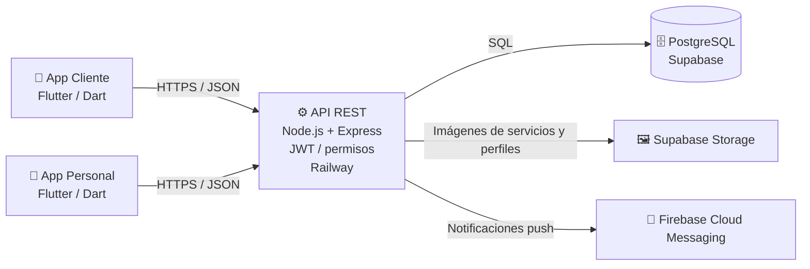
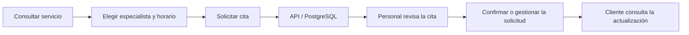

<div align="center">

# 🌸 Aura SPA

### Sistema móvil de gestión de citas y operación de un spa

Dos aplicaciones Flutter —**Cliente** y **Personal**— conectadas a una API REST compartida, una base de datos PostgreSQL y servicios en la nube.


**Universidad de Colima · Ingeniería de Software · Proyecto Integrador · 2026**

**Estado:** prototipo funcional integrado en `main`, con API desplegada y aplicaciones probadas en Android.

</div>

---

## 📖 Descripción del proyecto

**Aura SPA** es una solución para digitalizar la reserva de servicios y la administración diaria de un spa. Permite que los clientes consulten el catálogo, elijan un especialista y soliciten una cita desde su celular, mientras el personal organiza horarios, servicios, citas y atención.

El sistema utiliza **dos aplicaciones Flutter independientes** que consumen una **API REST desarrollada con Node.js y Express**. La información se almacena en **PostgreSQL alojado en Supabase** y el backend está desplegado en **Railway**.

El proyecto se enfoca en la gestión de citas; **no incluye pagos en línea**.

## ✨ Funcionalidades implementadas

### 📱 Aplicación Cliente (`app_cliente`)

- **Exploración sin iniciar sesión:** consulta del catálogo en modo invitado.
- **Catálogo de servicios:** búsqueda, categorías, información, duración, precio e imágenes.
- **Detalle de servicios:** información del tratamiento y reseñas disponibles.
- **Autenticación por correo:** acceso con contraseña, registro, verificación de correo mediante código y recuperación de contraseña.
- **Reserva de citas:** selección de servicio, especialista, fecha y horario disponible.
- **Gestión de citas:** consulta de próximas citas e historial; acciones de cancelación o reprogramación conforme a las reglas del sistema.
- **Favoritos:** servicios y especialistas preferidos.
- **Reseñas:** valoración de servicios y personal después de una atención elegible.
- **Perfil:** consulta y edición de datos personales y fotografía.
- **Notificaciones:** avisos dentro de la aplicación e integración con notificaciones push.
- **Preferencias visuales:** ajustes de idioma y apariencia.

> **Nota:** el inicio de sesión con Google no forma parte de la versión final. El acceso disponible es mediante correo electrónico y contraseña.

### 🧑‍💼 Aplicación Personal (`spa_admin_app`)

Una aplicación con inicio de sesión y navegación diferenciados según el rol:

| Rol | Funciones principales |
|---|---|
| **Administrador** | Panel de resumen, gestión de citas, empleados, servicios, asignaciones, horarios y consultas de reportes y reseñas. |
| **Recepción** | Operación de citas: registro manual, consulta, confirmación, reprogramación y cancelación, según permisos. |
| **Empleado** | Consulta de agenda y citas asignadas, además de las acciones habilitadas para su rol. |

Incluye, además:

- **Dashboard operativo** con indicadores de citas y actividades del día.
- **Gestión de servicios** y sus imágenes, categorías y disponibilidad.
- **Asignación de especialistas** a los servicios que realizan.
- **Administración de horarios** del personal.
- **Seguimiento de citas** por estado y registro de inasistencias conforme a la lógica establecida.
- **Perfil del personal**, con edición de información y fotografía.
- **Confirmaciones y avisos** antes de acciones relevantes, así como soporte para tema oscuro e idioma.

### 🔄 Reglas de operación relevantes

- Las citas pueden registrarse desde Cliente o manualmente desde el personal autorizado.
- Una cita creada manualmente comienza **Pendiente** y requiere confirmación explícita del personal.
- El personal autorizado puede confirmar, cancelar o reprogramar citas conforme a disponibilidad y permisos.
- Las inasistencias se registran como cancelaciones, sin crear un quinto estado de cita.
- Las operaciones se realizan mediante la API y persisten en PostgreSQL.
- La automatización del flujo es **interna**: no se contempla envío automático de mensajes por WhatsApp o SMS.
- Los procesos programados de recordatorios y cancelaciones automáticas están desactivados en el despliegue actual.

## 🏗️ Arquitectura



El backend es compartido por las dos aplicaciones. La autenticación utiliza **JWT** y los permisos dependen del rol del usuario.

### Flujo general de una reserva



## 🗃️ Modelo de datos

Las principales tablas del esquema relacional son:

| Tabla | Propósito |
|---|---|
| `roles`, `usuarios`, `puestos` | Acceso, permisos y estructura de roles. |
| `clientes`, `empleados` | Información de clientes y trabajadores. |
| `categorias`, `servicios` | Catálogo de tratamientos disponibles. |
| `empleado_servicios` | Relación entre especialistas y servicios. |
| `horarios` | Disponibilidad del personal. |
| `citas` | Reservas, estado, horarios, duración y precio aplicados. |
| `reservas_temporales` | Control temporal de reservas durante el proceso de agendamiento. |
| `resenas` | Calificaciones y comentarios. |
| `favoritos_servicios`, `favoritos_empleados` | Preferencias del cliente. |
| `notificaciones`, `dispositivos_fcm` | Avisos y registro de dispositivos para notificaciones. |
| `auditorias` | Registro de acciones de auditoría. |

Las imágenes de perfiles y servicios se almacenan en **Supabase Storage**; en PostgreSQL se conservan las referencias correspondientes.

## 🛠️ Tecnologías y herramientas

| Área | Tecnología |
|---|---|
| Aplicaciones Android | Flutter y Dart |
| Diseño y prototipado | Figma |
| Backend | Node.js, Express y API REST |
| Autenticación y autorización | JWT y control por roles |
| Base de datos | PostgreSQL en Supabase |
| Almacenamiento de imágenes | Supabase Storage |
| Notificaciones push | Firebase Cloud Messaging (FCM) |
| Despliegue del backend | Railway |
| Versionado y colaboración | Git y GitHub |
| Desarrollo y pruebas | VS Code, Android Studio y dispositivos Android |

## 🚀 Ejecución del proyecto

La versión integrada del código se encuentra en la rama **`main`**.

### Requisitos

- Flutter SDK y Android Studio correctamente configurados.
- Dispositivo Android con depuración USB habilitada o emulador disponible.
- Node.js, si se desea ejecutar la API localmente.
- Acceso a los servicios remotos y credenciales de prueba proporcionadas por el equipo (no incluidas en el repositorio).

### 1. Descargar el repositorio

```bash
git clone https://github.com/GenesisCampos100/APP_MOVIL_SPA.git
cd APP_MOVIL_SPA
```

### 2. Ejecutar App Cliente

```bash
cd app_cliente
flutter pub get
flutter devices
flutter run --dart-define=SPA_CLIENT_API_URL=https://appmovilspa-production.up.railway.app
```

### 3. Ejecutar App Personal

Desde la raíz del repositorio:

```bash
cd spa_admin_app
flutter pub get
flutter devices
flutter run --dart-define=SPA_API_URL=https://appmovilspa-production.up.railway.app/api
```

> Los comandos de Cliente y Personal se ejecutan **por separado**, dentro de la carpeta de cada aplicación. Si se utiliza un dispositivo concreto, puede indicarse con `-d ID_DEL_DISPOSITIVO`.

### 4. Ejecutar el backend localmente (opcional)

Desde la raíz del repositorio:

```bash
cd SpaBackend
npm ci
node server.js
```

Para ejecutar el backend localmente es necesario configurar sus **variables de entorno privadas** (conexión PostgreSQL, JWT y servicios externos). No se deben publicar contraseñas, claves de Supabase ni credenciales de Firebase en GitHub. Si se utiliza la API local, debe ajustarse la URL de conexión en las apps.

La API desplegada en Railway permite probar las apps sin iniciar `server.js` en la computadora, siempre que el servicio y su base de datos estén disponibles.

## 📁 Estructura del repositorio

```text
APP_MOVIL_SPA/
├── app_cliente/                 # Aplicación Flutter para clientes
│   ├── lib/
│   │   ├── core/                # Tema, idioma y navegación
│   │   ├── data/                # Modelos, repositorios y servicios
│   │   ├── features/            # Pantallas y funcionalidades
│   │   └── shared/              # Componentes reutilizables
│   └── assets/                  # Fuentes e imágenes
├── spa_admin_app/               # Aplicación Flutter para personal
│   ├── lib/
│   │   ├── core/
│   │   ├── data/
│   │   ├── features/            # Administrador, Recepción y Empleado
│   │   └── shared/
│   └── assets/
├── SpaBackend/                  # Backend compartido Node.js / Express
│   ├── src/
│   │   ├── config/
│   │   ├── controllers/
│   │   ├── jobs/
│   │   ├── middlewares/
│   │   ├── routes/
│   │   └── services/
│   ├── package.json
│   └── server.js
├── pruebas/                     # Scripts de pruebas del proyecto
└── README.md
```

## 👥 Equipo de desarrollo

| Integrante | Responsabilidad principal |
|---|---|
| **Génesis** | Liderazgo, coordinación técnica, integración y apoyo en el desarrollo. |
| **Kevin** | Frontend de la aplicación Cliente. |
| **Zinedine** | Frontend de la aplicación Personal y apoyo en pruebas. |
| **Vanessa** | Backend, API, autenticación y lógica de negocio. |
| **Mario** | Diseño y administración de PostgreSQL. |
| **Máximo** | UX/UI, pruebas y documentación. |

## 🗓️ Evolución del proyecto

| Etapa | Hito | Situación |
|---|---|---|
| **Fase I** | Análisis, requerimientos, casos de uso y prototipos · 18 sep 2026 | ✅ Completada |
| **Fase II** | Prototipo funcional e integración inicial con la base de datos · 7 oct 2026 | ✅ Completada |
| **Fase III** | Integración final, pruebas y documentación · 18 nov 2026 | ✅ Versión funcional integrada; cierre académico en preparación |

El repositorio contiene la versión integrada para demostración. Los datos de presentación pueden prepararse en la base de datos sin modificar el código fuente.

## 🔒 Consideraciones de seguridad y alcance

- Las credenciales, secretos y archivos `.env` **no deben subirse** al repositorio.
- El acceso a funciones internas se protege mediante autenticación y autorización por rol.
- Las contraseñas y datos reales de usuarios no se publican como credenciales de prueba.
- GitHub almacena el código; **no sustituye el respaldo de PostgreSQL ni de los archivos de Supabase Storage**.
- No se ofrecen pagos en línea ni autenticación con Google en esta versión.

---

<div align="center">

**Desarrollado por el equipo Aura SPA 💗**  
Universidad de Colima · Proyecto Integrador · 2026

</div>
